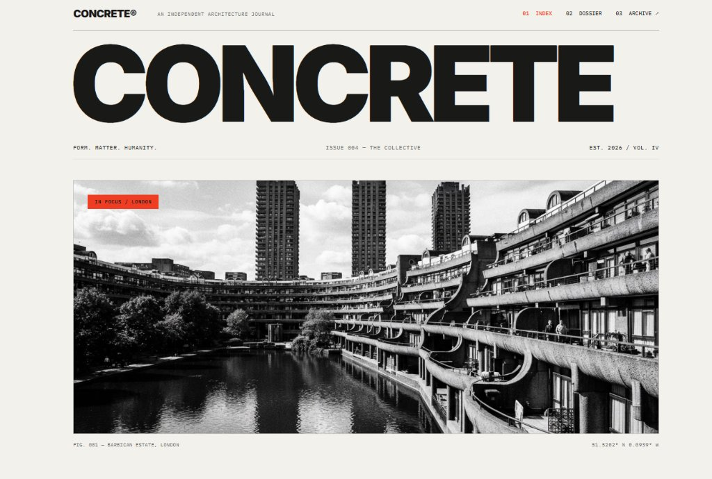

# CONCRETE

An independent architecture journal documenting brutalism and the built world.

[](https://concrete-aew.pages.dev/)

---



---

## Stack

- **Next.js 15** — App Router, static export
- **TypeScript** + **Tailwind CSS**
- **Cloudflare Pages** — hosting

## Routes

| Path | Description |
|---|---|
| `/` | Homepage — featured building |
| `/archive` | Full index of 18 buildings |
| `/buildings/[slug]` | Individual building pages |

## Local Development

```bash
npm install
npm run dev
```

## Build

```bash
npm run build   # outputs to /out
```

## Deploy

Pushes to `main` auto-deploy via Cloudflare Pages.

---

*Form. Matter. Humanity.*
